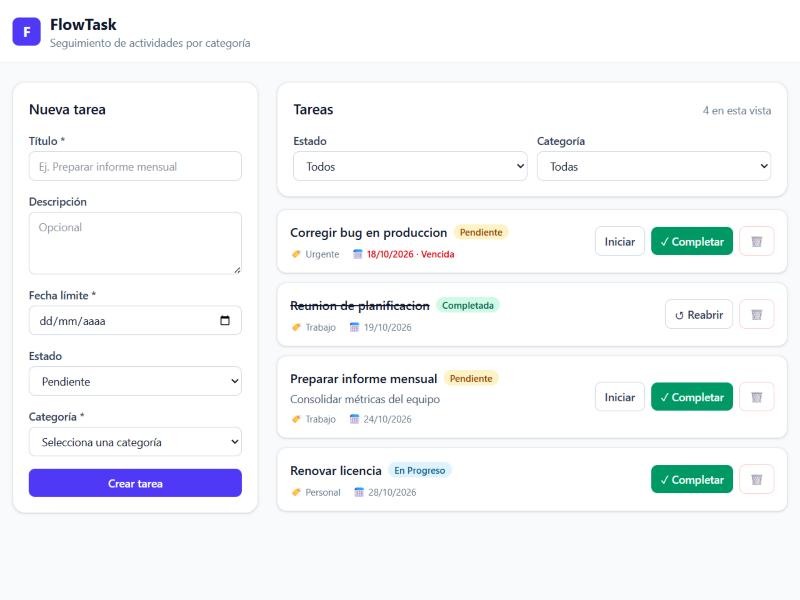

# FlowTask

Aplicación para llevar el seguimiento de tareas de un equipo pequeño. Cada tarea pertenece a una categoría (un área o proyecto) y pasa por tres estados: Pendiente, En Progreso y Completada.



## Tecnologías

- Backend: Python 3.10+ con FastAPI y Pydantic v2
- Base de datos: SQLite, usando SQLAlchemy 2.x como ORM
- Frontend: Angular 22 con TypeScript y Tailwind CSS 4
- Pruebas: pytest con el TestClient de FastAPI
- Docker Compose para levantar todo junto (el frontend se sirve con nginx)

## Estructura

```
FlowTask/
├── backend/
│   ├── app/
│   │   ├── core/           # configuración, enums y excepciones propias
│   │   ├── models/         # modelos de SQLAlchemy (las tablas)
│   │   ├── schemas/        # esquemas de Pydantic (lo que entra y sale de la API)
│   │   ├── repositories/   # consultas a la base de datos
│   │   ├── services/       # reglas de negocio
│   │   ├── routers/        # endpoints
│   │   ├── dependencies.py # inyección de los services con Depends
│   │   ├── database.py     # engine, sesión y get_db
│   │   └── seed.py         # lógica de la semilla
│   ├── tests/
│   ├── main.py             # crea la app, CORS, routers y manejo de errores
│   └── seed.py             # script para correr la semilla: python seed.py
├── frontend/
│   └── src/app/
│       ├── core/           # modelos, servicios HTTP e interceptor de errores
│       ├── features/tasks/ # TaskBoard, TaskForm, FilterBar, TaskList, TaskCard
│       └── shared/         # avisos (notificaciones)
└── docker-compose.yml
```

## Requisitos

- Python 3.10 o superior
- Node.js 22.22+ o 24.15+ con npm, lo pide Angular 22
- Docker Desktop, solo si se quiere usar la opción con Docker

## Cómo levantar el proyecto

Hacen falta dos terminales abiertas a la vez, una para el backend y otra para el frontend. Los comandos se escriben de uno en uno, y las líneas que empiezan con `#` son solo notas.

### La primera vez

Después de clonar hay que preparar las dos partes. Esto se hace una sola vez.

Backend:

```bash
git clone https://github.com/PieroMateo/flowtask.git
cd flowtask/backend

# crea el entorno virtual, una carpeta .venv con su propio python
python -m venv .venv

# lo activa, usar solo la línea de tu sistema
.venv\Scripts\activate          # windows
source .venv/bin/activate       # linux / macos

# instala fastapi, sqlalchemy y lo demás dentro de .venv
pip install -r requirements.txt

# crea la base de datos con las categorías trabajo, personal y urgente
# se puede saltar, el backend lo hace solo al arrancar
python seed.py
```

Frontend, en otra terminal y desde la carpeta del repo:

```bash
cd frontend

# descarga angular y las demás librerías en node_modules
npm install
```

### Cada vez que se quiera usar

Primero el backend, en la terminal 1:

```bash
cd backend

# hay que activarlo en cada terminal nueva
.venv\Scripts\activate          # windows
source .venv/bin/activate       # linux / macos

uvicorn main:app --reload
```

Cuando aparezca `Application startup complete` el backend ya está listo. Esa terminal queda ocupada mientras el servidor corre, y se apaga con Ctrl + C.

Después el frontend, en la terminal 2:

```bash
cd frontend
npm start
```

Cuando diga `Local: http://localhost:4200/` se abre esa dirección en el navegador. La API queda en http://localhost:8000 y su documentación de Swagger en http://localhost:8000/docs.

Si la página se abre con el backend apagado sale un aviso rojo. Basta con encender el backend y pulsar "Reintentar".

Si el entorno quedó activado, la terminal muestra `(.venv)` al inicio de la línea. En PowerShell a veces la activación falla con un error de "ejecución de scripts deshabilitada". Se soluciona corriendo una vez `Set-ExecutionPolicy -Scope CurrentUser RemoteSigned` y volviendo a activar.

La semilla revisa qué categorías ya existen antes de insertar, así que correrla varias veces no duplica nada.

## Con Docker

```bash
docker compose up --build
```

El frontend queda en http://localhost:4200 y el backend en http://localhost:8000/docs. La base de datos se guarda en el volumen `flowtask-data`, así que las tareas no se pierden al reiniciar los contenedores. Para borrarlas se usa `docker compose down -v`.

## Pruebas

Con el entorno virtual activado:

```bash
cd backend
pytest -v
```

Cada prueba trabaja con una base de datos SQLite en memoria que se crea y se borra en el momento, por eso nunca modifican `flowtask.db`.

## Endpoints

- `GET /categories` devuelve todas las categorías.
- `GET /tasks` lista las tareas. Se pueden filtrar por `status` y `category_id`, y paginar con `limit` (de 1 a 100, por defecto 50) y `offset`.
- `GET /tasks/{id}` devuelve una tarea.
- `POST /tasks` crea una tarea y responde 201.
- `PATCH /tasks/{id}` cambia solo los campos que se manden, por ejemplo el `status`.
- `DELETE /tasks/{id}` borra la tarea y responde 204, sin contenido.

Si el id de la URL no existe la API responde 404, y si los datos que se mandan no son válidos responde 422.

Ejemplo para crear una tarea:

```json
POST /tasks
{
  "title": "Preparar informe mensual",
  "description": "Consolidar métricas del equipo",
  "status": "Pendiente",
  "due_date": "2026-10-30",
  "category_id": 1
}
```

Todos los errores tienen la forma `{"detail": ...}`. Por ejemplo, `GET /tasks/99999` responde `404 {"detail": "Tarea no encontrada"}`.

## Decisiones de Diseño y Arquitectura

### El backend en capas

Separé el backend para que cada petición pase por `router`, luego `service`, luego `repository` y recién ahí llegue a la base de datos.

Los routers solo se encargan de lo que tiene que ver con HTTP: la ruta, los parámetros, el código de respuesta y el `response_model`. Cada endpoint tiene una sola línea que llama al service.

En los services están las reglas, por ejemplo revisar que la tarea o la categoría existan. No importan nada de FastAPI. Cuando algo está mal lanzan una excepción propia y es `main.py` quien decide qué código HTTP devolver.

Los repositories tienen las consultas de SQLAlchemy. Si mañana se cambia de base de datos o la forma de consultar, la lógica de los services no se toca.

Con esta separación cada parte se puede probar por su lado. En los tests, por ejemplo, cambio la base de datos real por una en memoria con `dependency_overrides` sin modificar ninguna capa.

### Modelos y esquemas por separado

Los modelos de SQLAlchemy describen cómo se guardan los datos y los esquemas de Pydantic describen lo que recibe y devuelve la API. Por eso `TaskCreate` no acepta `id`, `TaskUpdate` tiene todos sus campos opcionales para el PATCH, y `TaskRead` trae la categoría completa adentro para que el frontend muestre el nombre sin tener que hacer otra petición.

### Validaciones

Las validaciones están en dos lugares. Pydantic revisa la forma de los datos y responde 422 solo: que el título no esté vacío (también le quita los espacios de los lados), que el estado sea uno de los tres permitidos y que la fecha sea válida. Lo que necesita consultar la base de datos, como que el `category_id` exista, lo revisa el service.

Los estados están definidos una sola vez en un `Enum` (`app/core/enums.py`) que usan el modelo, los esquemas y los filtros. En el frontend `TASK_STATUSES` cumple el mismo papel.

### Manejo de errores

Los services lanzan `NotFoundError` o `InvalidReferenceError` y un manejador en `main.py` las convierte en una respuesta JSON. Así los services no dependen de HTTP y un recurso que no existe nunca termina en un error 500. También agregué un manejador para cualquier error que no esté previsto, que lo deja registrado en la consola y al cliente le devuelve un mensaje simple sin detalles internos.

Elegí 404 cuando lo que no existe es el recurso de la URL (`/tasks/99999`) y 422 cuando el body apunta a una categoría que no existe. En ese segundo caso la ruta `/tasks` sí existe, el problema está en los datos que se mandaron.

En el PATCH, si se manda un campo obligatorio en `null` (por ejemplo `{"title": null}`) se rechaza con 422. Sin esa validación el valor llegaba a la base de datos y terminaba en un error de integridad.

### Base de datos

Usé SQLite porque no hace falta instalar ningún servidor. La conexión se lee de la variable de entorno `DATABASE_URL`, así que pasar a PostgreSQL sería cambiar esa variable e instalar el driver.

SQLite trae las llaves foráneas desactivadas, por eso las activo con `PRAGMA foreign_keys=ON` en cada conexión.

Al listar tareas uso `selectinload` para traer las categorías en una sola consulta extra y no una por cada tarea (el problema N+1). El orden es por fecha límite y después por `id`, así la paginación no cambia de orden entre una página y otra.

### CORS

Solo se permite el origen `http://localhost:4200` (se puede cambiar con `CORS_ORIGINS`), los métodos que la API usa (`GET`, `POST`, `PATCH`, `DELETE`) y el encabezado `Content-Type`.

### Frontend

`TaskService` y `CategoryService` son los únicos que usan `HttpClient`, ningún componente hace peticiones directamente. Las interfaces `Task`, `Category`, `TaskCreate` y `TaskUpdate` copian los esquemas del backend.

`TaskBoard` es el componente que guarda el estado y llama a los servicios. `FilterBar`, `TaskList` y `TaskCard` solo reciben datos con `input()` y avisan con `output()` cuando el usuario hace algo. `TaskForm` es la excepción: hace su propio POST porque necesita saber cuándo termina para limpiar el formulario y volver a habilitar el botón.

Todo el estado está en signals. Gracias a eso la app funciona sin Zone.js y la pantalla se actualiza en cuanto se crea, completa o elimina una tarea, sin recargar.

Los errores los maneja un interceptor que distingue tres casos: el backend no responde (`status 0`), un error nuestro (`detail` como texto) o un error de validación de Pydantic (`detail` como lista).

Cuando se cambia de filtro se cancela la petición anterior, porque si no una respuesta que llega tarde podía reemplazar a la más reciente. Además, mientras una tarea espera respuesta sus botones se desactivan para que un doble clic no mande la petición dos veces.


